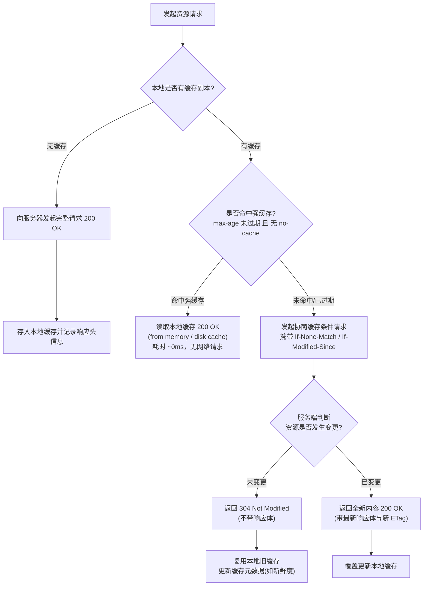
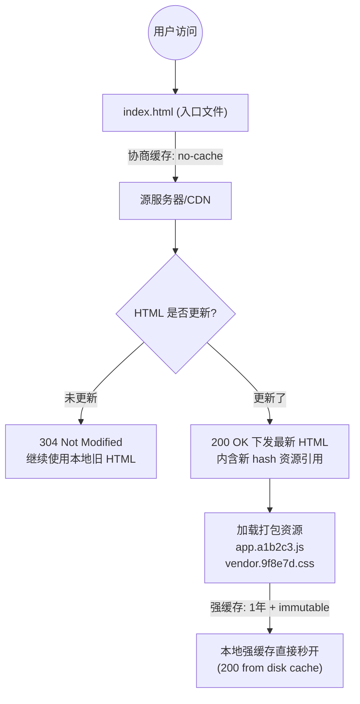

# HTTP 缓存机制详解

HTTP 缓存是 Web 性能优化的核心手段之一。通过复用之前获取的资源副本，可以显著**降低网络延迟、减少服务器负载并节约带宽流量**。

HTTP 缓存主要由服务端通过响应标头（Response Headers）进行控制，客户端（浏览器）和网络中间节点（CDN、反向代理）按规范配合执行。

---

## 1. 缓存整体决策流程

当浏览器发起一个资源请求时，整体判断链路如下：



---

## 2. 强缓存 (Strong Cache)

强缓存是速度最快的缓存机制。当命中强缓存时，**浏览器完全不向服务器发送任何网络请求**，直接从本地存储读取数据。

### 2.1 开发者工具表现
在浏览器 DevTools 的 Network 面板中：
* **Status**：`200 OK`
* **Size**：`(from memory cache)` 或 `(from disk cache)`
* **Time**：通常为 `0 ms`

> **内存缓存 (Memory Cache) vs 磁盘缓存 (Disk Cache)**
> * **Memory Cache**：存在进程内存中，读取速度最快，但生命周期随页面 Tab 或进程关闭而销毁。常用于 Base64 图片、当前页面刚刚解析使用的 CSS/JS 等。
> * **Disk Cache**：存在硬盘中，读取速度略逊于内存但具备持久性，容量更大，重启浏览器依然有效。大体积文件、长效静态资源一般存入磁盘。

### 2.2 控制响应头与优先级

| 响应头字段 | 引入规范 | 时间类型 | 机制说明 | 优缺点 |
| :--- | :--- | :--- | :--- | :--- |
| `Cache-Control: max-age=<seconds>` | HTTP/1.1 | **相对时间**（秒） | 资源自生成或获取后的有效时长（如 `max-age=31536000` 表示 1 年内有效）。 | **现代标准，绝对优先**。不受客户端本地时间偏差或人为篡改的影响。 |
| `Expires` | HTTP/1.0 | **绝对时间**（GMT 格式） | 指定到期具体时间点，如 `Expires: Wed, 21 Oct 2026 07:28:00 GMT`。 | **历史遗留**。严重依赖客户端本地时钟，若客户端时间不准会导致过早失效或永不失效。 |

**优先级规则**：
当 `Cache-Control: max-age` 与 `Expires` 同时存在时，**`Cache-Control: max-age` 具有绝对优先级**，`Expires` 会被直接忽略。

---

## 3. 协商缓存 (Conditional Cache)

当强缓存失效（超过 `max-age`）、被显式跳过（配置了 `Cache-Control: no-cache`）或用户手动刷新时，浏览器必须向服务器发起验证请求。

服务器通过比对资源的指纹或修改时间来决定：
* **资源未改变**：返回轻量响应 **`304 Not Modified`**（仅包含响应头，无响应体），通知客户端继续复用本地缓存。
* **资源已变动**：返回 **`200 OK`**，下发最新资源体并更新验证标头。

协商缓存由两对标头协同工作：

```
首次响应：  ETag             /  Last-Modified
再次请求：  If-None-Match    /  If-Modified-Since
```

### 3.1 方案一：ETag 与 If-None-Match（内容指纹）

`ETag`（Entity Tag）是服务器根据文件内容计算出的**唯一哈希/特征标识符**。

1. **初次获取**：服务器返回资源并附带响应头：
   ```http
   HTTP/1.1 200 OK
   ETag: "w/1a2b3c4d"
   ```
2. **再次请求**：本地强缓存失效后，浏览器自动将该值填入 `If-None-Match` 请求头发送：
   ```http
   GET /app.js HTTP/1.1
   Host: example.com
   If-None-Match: "w/1a2b3c4d"
   ```
3. **服务端校验**：服务器计算当前资源的最新 ETag。若一致则返回 `304 Not Modified`；若不一致则返回 `200 OK` 及新 ETag 与内容。

> **强 ETag 与 弱 ETag**：
> * **强 ETag**（如 `"abc"`）：要求字节级完全一致。
> * **弱 ETag**（如 `W/"abc"`）：前缀带 `W/`，仅要求语义等价，允许细微字节差异（常用于压缩转换场景）。

### 3.2 方案二：Last-Modified 与 If-Modified-Since（时间戳）

`Last-Modified` 记录资源在服务器操作系统上的**最后修改时间**。

1. **初次获取**：服务器响应最后修改时间：
   ```http
   HTTP/1.1 200 OK
   Last-Modified: Fri, 23 Oct 2026 09:30:00 GMT
   ```
2. **再次请求**：强缓存失效后，浏览器自动把该时间作为 `If-Modified-Since` 发送：
   ```http
   GET /logo.png HTTP/1.1
   Host: example.com
   If-Modified-Since: Fri, 23 Oct 2026 09:30:00 GMT
   ```
3. **服务端校验**：服务器判断该时间之后文件是否改动。未改动返回 `304`，改动返回 `200`。

### 3.3 ETag vs Last-Modified 对比

| 对比维度 | `ETag` / `If-None-Match` | `Last-Modified` / `If-Modified-Since` |
| :--- | :--- | :--- |
| **精度** | **精确到内容哈希** | **秒级（1s）** |
| **判定逻辑** | 基于文件内容是否变化 | 基于文件属性中的修改时间 |
| **计算开销** | 略高（需计算 Hash 或摘要） | 极低（直接读取文件元数据属性） |
| **局限性与缺陷** | 分布式多机集群若算法不一致可能抖动 | 1. 1 秒内的频繁变更无法捕获<br/>2. 文件被 `touch` 打开保存但内容没变也会导致缓存失效<br/>3. 分布式服务器各机 mtime 同步可能存在误差 |
| **优先级** | **高（优先处理）** | **低（次级兜底）** |

> **最佳实践**：两者可同时配置。服务端收到请求时，会优先比对 `If-None-Match`；两者均满足时才视为未修改返回 `304`。

---

## 4. 私有缓存 vs 共享缓存

HTTP 缓存根据**存储位置、服务对象及安全边界**分为私有缓存与共享缓存两大类：

| 维度 | 私有缓存 (Private Cache) | 共享缓存 (Shared Cache) |
| :--- | :--- | :--- |
| **部署位置** | 客户端本地（单用户的浏览器、App Webview 等） | 中间代理节点（CDN、反向代理、公司网关等） |
| **服务对象** | **单一特定用户** | **多个不同用户（公用共享）** |
| **典型内容** | 个人中心资料、私人订单、含鉴权身份的数据 | 公共静态资源（JS/CSS/字体/图片）、全网公共 API |
| **响应头声明** | `Cache-Control: private, max-age=300` | `Cache-Control: public, s-maxage=3600` |

### 4.1 核心指令差异：`max-age` 与 `s-maxage`
* `max-age`：同时作用于浏览器和共享代理（若没有声明 `s-maxage`）。
* `s-maxage`（Shared Max Age）：**仅对共享缓存（如 CDN、代理服务器）生效**。如果同时存在，CDN 会以 `s-maxage` 为准，而最终用户的浏览器仍以 `max-age` 为准。

### 4.2 服务端配置示例 (Express)

```javascript
import express from 'express';
const app = express();

// 1. 私有缓存：仅当前用户浏览器缓存 5 分钟，严禁 CDN 缓存
app.get('/api/user/profile', (req, res) => {
  res.set('Cache-Control', 'private, max-age=300').json({ userId: 1001, name: 'Alice' });
});

// 2. 共享分层缓存：浏览器缓存 1 分钟，CDN 节点缓存 1 小时
app.get('/api/public-banner', (req, res) => {
  res.set('Cache-Control', 'public, max-age=60, s-maxage=3600').json({ banner: 'https://...' });
});

// 3. 彻底禁用缓存：支付/密码等极度敏感数据，一律不得暂存
app.get('/api/pay/status', (req, res) => {
  res.set('Cache-Control', 'no-store').json({ orderId: 8888, status: 'PAID' });
});

app.listen(3000);
```

---

## 5. Cache-Control 核心指令全景速查

`Cache-Control` 是 HTTP/1.1 引入的最关键控制指令，可组合使用（用逗号分隔）：

| 分类 | 指令 | 作用与含义 |
| :--- | :--- | :--- |
| **可缓存性** | `public` | 任何中间节点（CDN、代理）和客户端均可缓存。 |
| | `private` | **仅允许最终客户端缓存**，中间代理/CDN 严禁缓存。 |
| | `no-cache` | **可以缓存到本地**，但每次使用前**必须向源服务器发起协商缓存验证**。 |
| | `no-store` | **彻底禁止任何形式的缓存**，不存副本，每次必须拉取完整资源。 |
| **有效期** | `max-age=<秒>` | 资源在客户端被视为新鲜（Fresh）的最大生存秒数。 |
| | `s-maxage=<秒>` | 仅对**共享缓存（CDN/代理）**生效的有效时长，覆盖 `max-age`。 |
| **校验与重试** | `must-revalidate` | 缓存一旦过期，**严禁使用陈旧缓存响应**，必须向源站验证；若源站不可达直接报错。 |
| | `immutable` | 告知客户端在 `max-age` 内**资源内容永不变更**，即使用户主动刷新（F5）也跳过验证。 |
| **容灾与异步** | `stale-while-revalidate=<秒>` | 缓存过期后的一定窗口内，允许先秒开旧缓存，同时在后台异步向源站拉取新版本。 |

### 核心辨析：`no-cache` 与 `no-store`
* **`no-cache` 不是“不缓存”**：它的真实含义是**“不经协商验证不得直接使用缓存”**。本地依然会下载存储资源文件，只是下次使用时一定会发一次携带 `ETag` 的条件请求。
* **`no-store` 才是真正的“不存储”**：浏览器和代理服务器绝不在硬盘或内存留存任何资源副本，用于银行支付、身份证号、密钥等机密场景。

---

## 6. 用户操作对缓存机制的影响

用户在浏览器端的不同触发方式，会改写请求头并影响缓存判定路径：

| 用户操作方式 | 浏览器默认行为 | 强缓存判定 | 协商缓存判定 | 结果表现 |
| :--- | :--- | :---: | :---: | :--- |
| **地址栏输入 URL / 回车** | 正常加载 | **生效** | 强缓存失效后生效 | 优先命中强缓存 (`200 from cache`) |
| **点击页面超链接 / 页面前进后退** | 正常加载 | **生效** | 强缓存失效后生效 | 优先命中强缓存 (`200 from cache`) |
| **普通刷新 (F5 / Cmd+R / 刷新按钮)** | 请求头附带 `Cache-Control: max-age=0` | **跳过** | **生效** | 强缓存被无视，发送条件请求验证 (`304` 或 `200`) |
| **强制刷新 (Ctrl+F5 / Cmd+Shift+R)** | 请求头附带 `Cache-Control: no-cache`、`Pragma: no-cache`，**不带验证头** | **跳过** | **跳过** | 跳过一切本地缓存，从源站下载全新资源 (`200 OK`) |

> **注**：为静态资源配置 `immutable` 指令（如 `Cache-Control: max-age=31536000, immutable`）时，用户在页面内按 `F5` 普通刷新，浏览器也会坚决读取强缓存，不再向服务器发协商请求。

---

## 7. 前端工程化最佳缓存实践 (SPA 架构)

现代 Web 应用（如 Vue / React 单页应用）标准部署方案采用**“非覆盖式发布 + 动静分离”**策略：



### 7.1 分层配置方案

#### 1. 入口文件 `index.html`
* **策略**：**严禁强缓存，强制每次走协商缓存**。
* **原因**：前端打包后的入口负责引入所有带 hash 的 JS/CSS 文件。如果 `index.html` 被强缓存，前端发布上线后用户无法及时感知更新。
* **响应头**：
  ```http
  Cache-Control: no-cache
  ```

#### 2. 带 Hash 的打包产物 (`*.js`, `*.css`, 字体, 音视频)
* **策略**：**永久强缓存 + 独一无二文件名**。
* **原因**：现代构建工具（Vite、Webpack）会在打包时计算文件内容指纹（如 `index.4b8c9d.js`）。内容变更文件名必改；内容不变文件名永不改。因此可以放心地设置 1 年或更长时间的强缓存。
* **响应头**：
  ```http
  Cache-Control: public, max-age=31536000, immutable
  ```

#### 3. 动态业务 API (`/api/*`)
* **策略**：视数据实时性与隐私级别而定。
  * **敏感数据**（用户账户、鉴权信息）：`Cache-Control: no-store`
  * **高频读公共数据**（商品详情、文章列表）：`Cache-Control: public, max-age=60, stale-while-revalidate=300`

### 7.2 Nginx 生产环境典型配置

```nginx
server {
    listen 80;
    server_name example.com;
    root /var/www/html;

    # 1. HTML 入口文件：走协商缓存，确保发版即生效
    location = /index.html {
        add_header Cache-Control "no-cache";
    }

    # 2. 带 Hash 指纹的静态资源目录：永久强缓存
    location ^~ /assets/ {
        expires 1y;
        add_header Cache-Control "public, max-age=31536000, immutable";
    }

    # 3. 业务 API 反向代理：禁用缓存
    location /api/ {
        proxy_pass http://api_server;
        add_header Cache-Control "no-store";
    }
}
```
